# Coriolis Companion App


Character sheets, ship sheets, dice, and GM tools for the _Coriolis: The
Third Horizon_ tabletop RPG (Free League Publishing). A fan project — not
affiliated with the publisher.

> **Beta.** All seven planned phases (§11 of [`PRD.md`](docs/PRD.md)) shipped:
> auth, character + ship sheets, dice + game sessions + Darkness Points,
> GM tools, and hardening (offline read + write on web and mobile, JSON
> export, Lighthouse + Grafana gates, tag-on-merge release workflow).
> The remaining v1.0 launch checklist — production hosting, web Sentry
> integration, full Grafana dashboard set, and the mobile cold-start
> profile — is tracked in [`docs/done/phase-7.md`](docs/done/phase-7.md)
> § "Deferred / open follow-ups".

Three first-class clients on day one served by a single backend:

- **`apps/web`** — Nuxt 4 SPA (`ssr: false`), Vue 3, Vite, Nuxt UI v4, Tailwind v4.
- **`apps/mobile`** — Flutter 3.41 / Dart 3.8, `flutter_bloc` + `get_it`.
- **`apps/backend`** — NestJS 11 with `@nestjs/cqrs`, Prisma 7, Postgres 18, Redis 8, Centrifugo v6, Better Auth.

The product spec is [`docs/PRD.md`](docs/PRD.md). The design language is
[`docs/DESIGN.md`](docs/DESIGN.md). The phased delivery plan is
[`docs/IMPLEMENTATION_PLAN.md`](docs/IMPLEMENTATION_PLAN.md). The agent
operating manual is [`AGENTS.md`](AGENTS.md).

🇷🇺 Russian summary: [`README.ru.md`](README.ru.md).

## Screenshots

> Captured against the local dev stack with
> [`scripts/screenshots/capture.ts`](scripts/screenshots/capture.ts). Run
> `pnpm screenshots:capture` to regenerate.

### Character sheet

The product's centre of gravity: attributes (1–5), the four-tier skill
list, talents, gear, conditions, encumbrance, and the share / push-roll
controls — all on one page, dark Coriolis palette throughout.

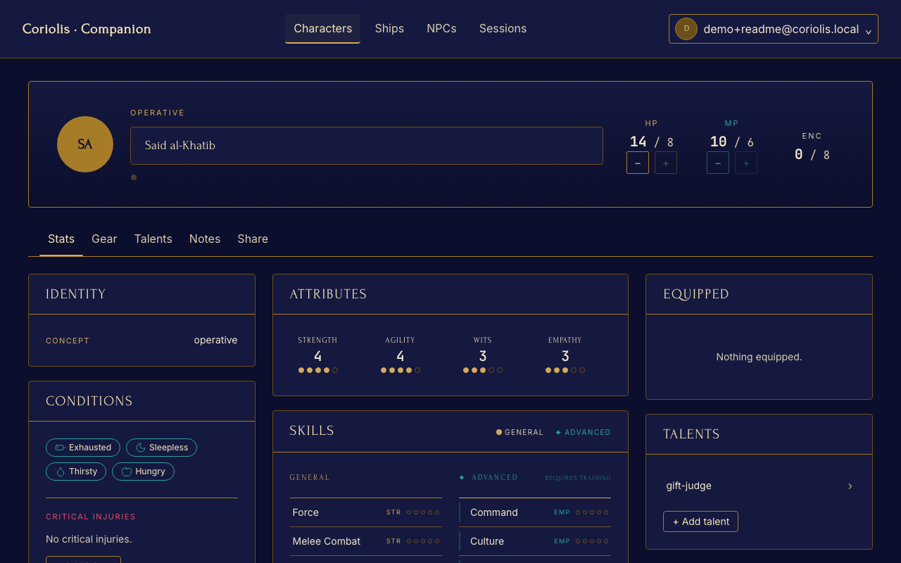

### Around the app

<table>
  <tr>
    <td width="50%"><a href="docs/screenshots/desktop/dashboard.png">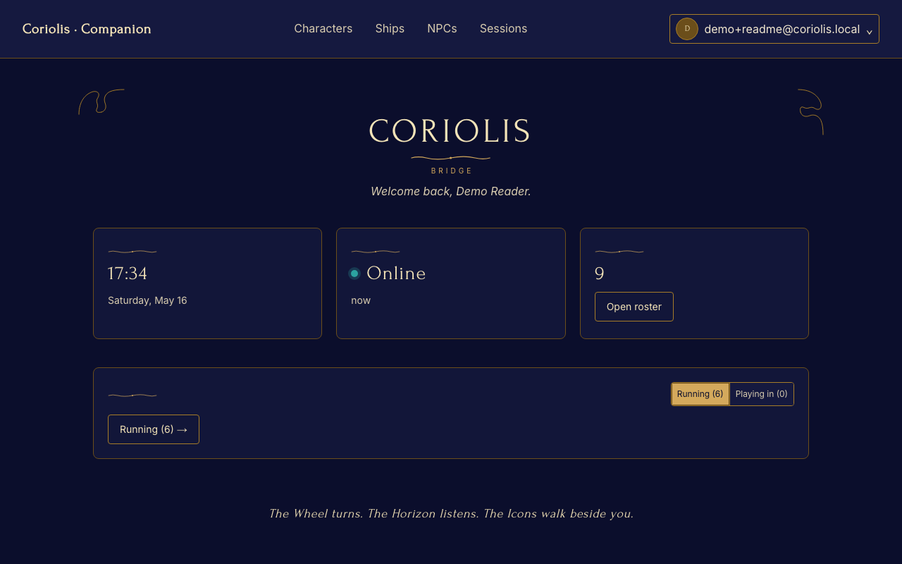</a><br/><sub><b>Bridge</b> — today's session at a glance.</sub></td>
    <td width="50%"><a href="docs/screenshots/desktop/characters-list.png">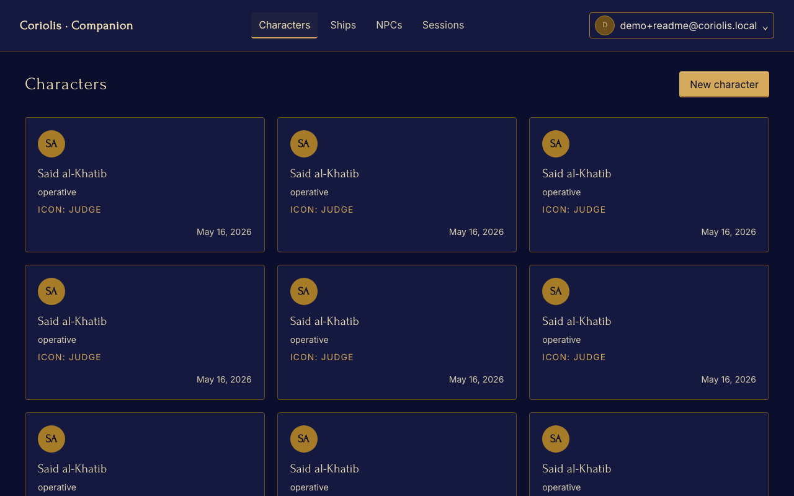</a><br/><sub><b>Characters</b> — your roster.</sub></td>
  </tr>
  <tr>
    <td width="50%"><a href="docs/screenshots/desktop/game-session.png">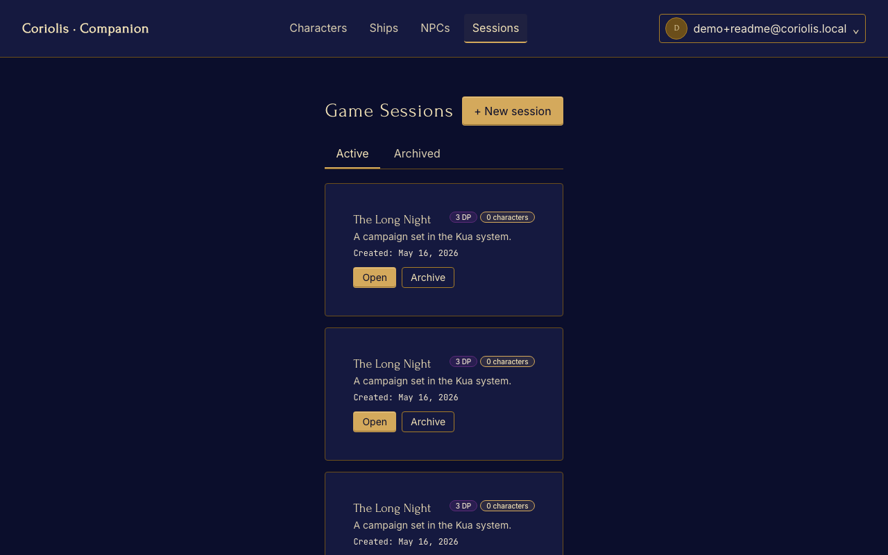</a><br/><sub><b>Game sessions</b> — DP tracker, members, archive.</sub></td>
    <td width="50%"><a href="docs/screenshots/desktop/npc-editor.png">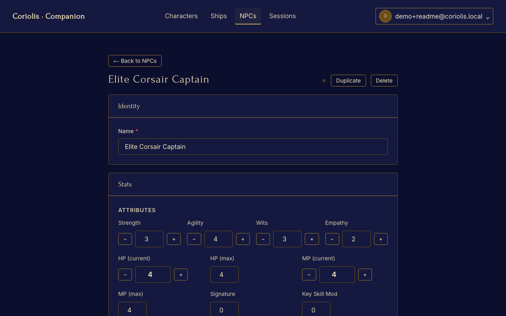</a><br/><sub><b>NPC editor</b> — GM-side enemies and allies.</sub></td>
  </tr>
  <tr>
    <td width="50%"><a href="docs/screenshots/desktop/shared-character.png">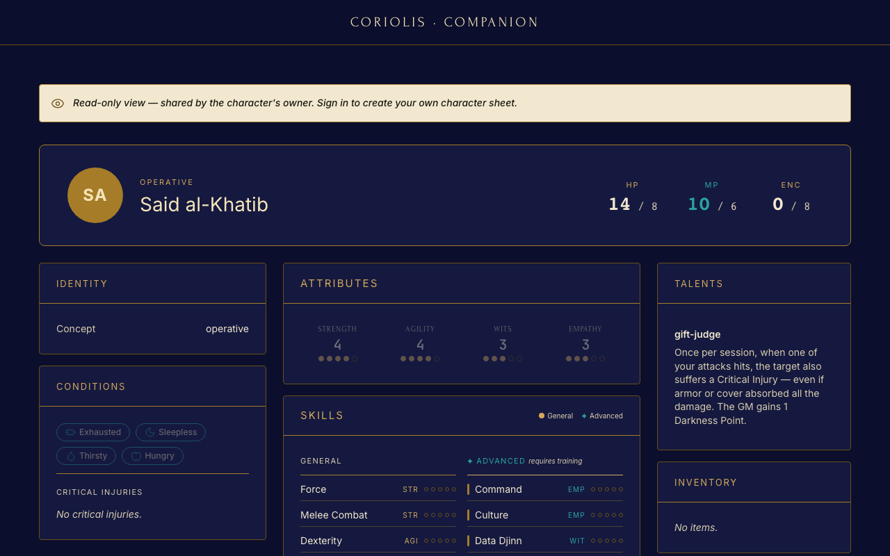</a><br/><sub><b>Public share</b> — read-only link with the GM-notes opt-out.</sub></td>
    <td width="50%"><a href="docs/screenshots/desktop/landing.png">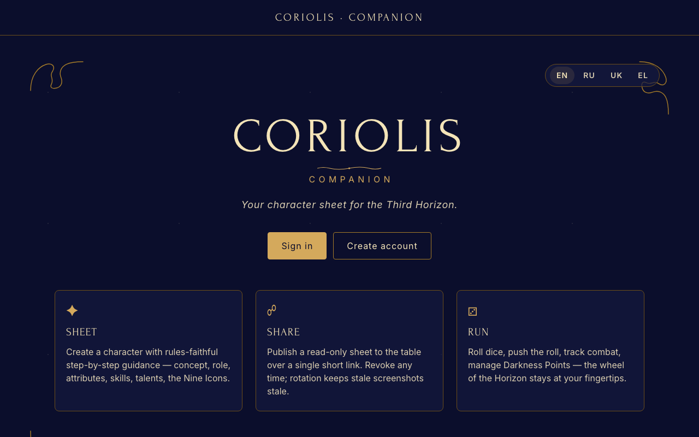</a><br/><sub><b>Landing</b> — three pillars: Sheet · Share · Run.</sub></td>
  </tr>
</table>

### Mobile (web-responsive at 414 × 896)

<table>
  <tr>
    <td width="25%">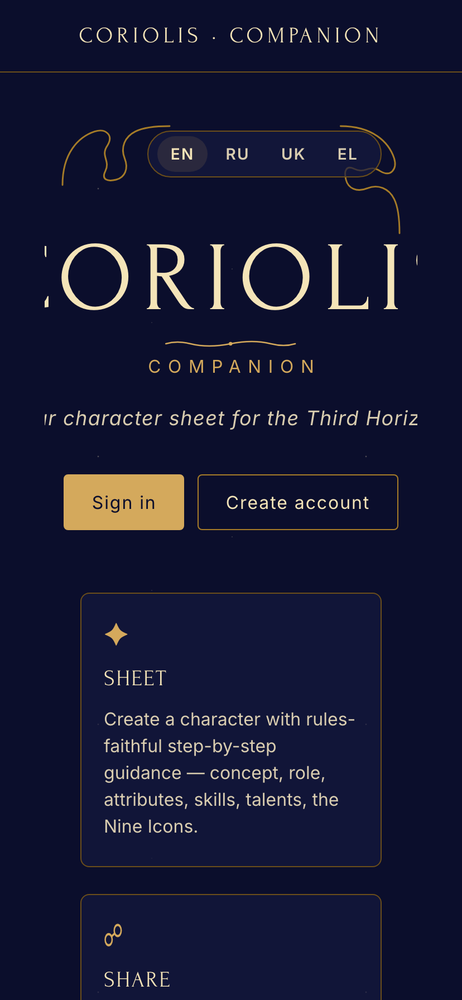</td>
    <td width="25%">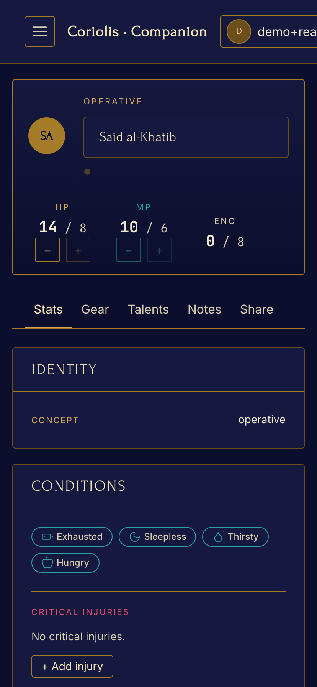</td>
    <td width="25%">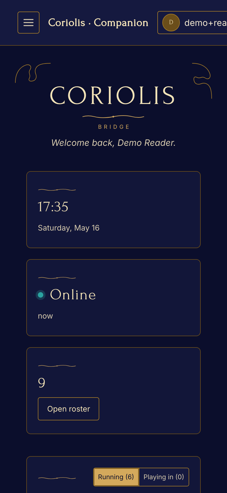</td>
    <td width="25%">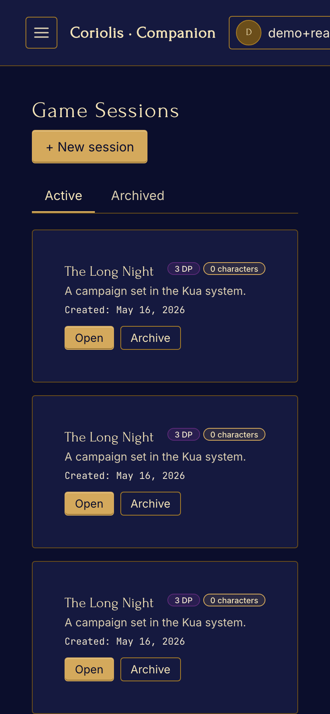</td>
  </tr>
  <tr>
    <td align="center"><sub>Landing</sub></td>
    <td align="center"><sub>Character sheet</sub></td>
    <td align="center"><sub>Bridge</sub></td>
    <td align="center"><sub>Sessions</sub></td>
  </tr>
</table>

> The native Flutter client (`apps/mobile`) renders the same data through
> Material widgets bound to the shared design tokens. Native screenshots
> are tracked in [`docs/done/phase-7.md`](docs/done/phase-7.md) and will
> be added once the cold-start profile lands.

## Features

### For players

- **Character sheets** — Coriolis-faithful: nine icons, concept,
  upbringing, attributes (1–5), the general / advanced skill split,
  talents, gear, conditions, encumbrance, critical injuries.
- **Dice rolls** — D6 pool with [`push`][rules-push] support; sixes are
  successes, ones unlock GM Darkness Points when the roll is pushed.
- **Public share links** — one-tap read-only view of your sheet for the
  rest of the table, with an opt-in GM-notes toggle and revoke.
- **JSON export** — your sheet, ship, and history exportable through
  `GET /api/v1/me/export` for sidecar tools and backups.
- **Offline** — read everywhere, write on web (ServiceWorker queue) and
  mobile (Hive cache); changes reconcile when you're back online.

### For game masters

- **Ship sheets** — 20 ship classes (ST3001 ГЛАВА 7), modules, crew
  positions, hull / energy / signature / armor, problem tracking.
- **Game sessions** — invite links, member roles, archive, the active
  Darkness Points tracker with history.
- **NPCs and encounters** — pre-genned and custom NPCs, encounter
  builder with initiative, round and turn advance.
- **Real-time table** — dice rolls, DP changes, and chat broadcast over
  Centrifugo; everyone at the table sees the same state.

### Across all clients

- **Three first-class clients** — Nuxt 4 SPA, Flutter 3.41
  (iOS / Android), and a NestJS 11 backend, all generated from the same
  OpenAPI + AsyncAPI specs.
- **Four locales** — English, Russian, Ukrainian, Greek. Locale parity
  is CI-enforced.
- **Branded design system** — `@app/ui` for Vue, `app_ui` for Flutter,
  driven by a single token pipeline (`specs/design/tokens/*.json`).
- **Observability** — OpenTelemetry → local Grafana / LGTM stack, Sentry
  on backend and mobile.

[rules-push]: https://frialigan.se/en/store/coriolis-rpg/

## Why these guardrails

This codebase is built for an **agent-driven workflow** (Claude Design →
Claude Code). The drift protections below stop the predictable failure
modes of AI-assisted greenfield work — fields renamed in TypeScript but not
in the Dart client, API routes added without updating the spec, hex colors
landing in components, locales going out of parity:

- One OpenAPI + one AsyncAPI file generate both the TypeScript and Dart
  clients. CI fails the PR if the generated output is out of date.
- `express-openapi-validator` rejects runtime requests that aren't in the
  spec — the backend physically cannot serve an undocumented route.
- Stylelint bans hex literals in brand components; every colour comes from
  a design token in `specs/design/tokens/*.json`.
- A task stack lives in the repo, not in a chat window: every feature is
  pushed onto `specs/tasks/active.md`, checked off as it progresses, and
  archived to `specs/tasks/done.md` with the PR link.
- `.claude/` carries the project rules, subagent roster, and a handbook per
  domain. A fresh Claude Code session picks them up automatically.

## Architecture at a glance

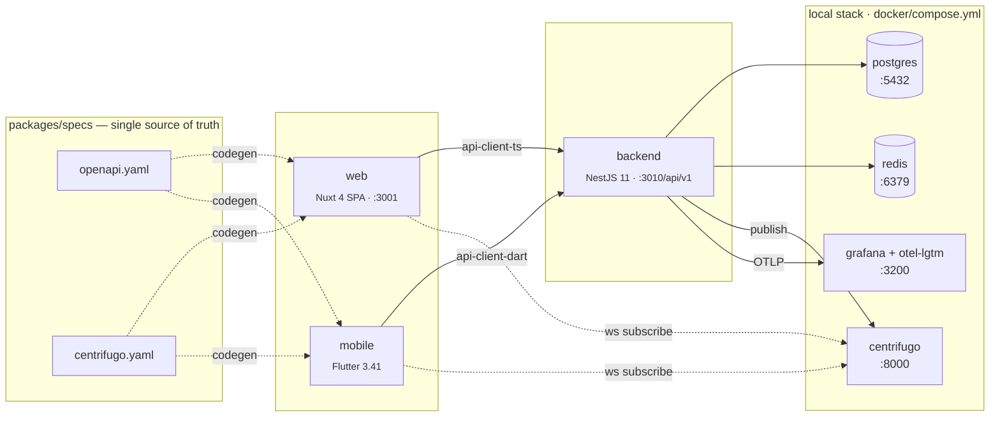

Wire contracts (`packages/specs`) are the single source of truth. Generated
clients (`packages/api-client-{ts,dart}`) are read-only — codegen owns them.

## What's in the box

### Backend — `apps/backend`

- NestJS 11 with CQRS (`@nestjs/cqrs`) and strict URI versioning at `/api/v1/*`
- Better Auth mounted under `/api/v1/auth/*`, backed by Prisma 7 tables
- Centrifugo realtime token endpoint (`POST /api/v1/realtime/token`, TTL ≤ 5 min)
- RFC 9457 `application/problem+json` error envelope via a global filter
- `express-openapi-validator` rejects any request or response that drifts
  from `packages/specs/openapi/openapi.yaml`
- Config module (`AppConfig`) — direct `process.env` access is banned
- Sentry + OpenTelemetry wired in `main.ts`
- nestjs-i18n, @nestjs/throttler, health endpoint with db / redis /
  centrifugo dependency status

### Web — `apps/web`

- Nuxt 4 in SPA mode (`ssr: false`), Nuxt UI v4, Tailwind v4
- `@nuxtjs/i18n` with per-component `<i18n lang="json">` blocks, not global
  message files (`useI18n({ useScope: 'local' })`)
- All HTTP goes through the generated `@app/api-client-ts`
- Auth state via Better Auth's `useSession()` + `AuthGate`-style layout
- SCSS with BEM naming, design tokens as CSS custom properties

### Mobile — `apps/mobile`

- Flutter 3.41, feature-first layout (`domain/data/presentation`)
- `flutter_bloc` for state, `get_it` for DI, Dio for HTTP
- Auth vertical: welcome / sign-in / sign-up screens, `AuthCubit`,
  `AuthGate`, token storage via `flutter_secure_storage`
- Firebase Messaging push integration, Sentry Flutter
- i18n via `slang`, four locales wired (en / ru / uk / el) across
  `auth` / `common` / `settings` / `coriolis` namespaces
- Linked to the shared design system (`app_ui` = `packages/ui_flutter`) and
  the generated Dart client (`app_api_client` = `packages/api-client-dart`)

### Shared contracts — `packages/specs`

- OpenAPI 3.1 (`openapi/openapi.yaml`) + AsyncAPI 3.0 (`asyncapi/centrifugo.yaml`)
- `pnpm spec:validate` (Redocly + AsyncAPI CLI)
- `pnpm spec:bundle` → `dist/openapi.json`
- `pnpm spec:codegen` regenerates:
  - `packages/api-client-ts/src/generated/` via `@hey-api/openapi-ts`
  - `packages/specs/src/openapi-types.ts` via `openapi-typescript`
  - `packages/api-client-dart/lib/generated/` via `openapi-generator-cli` (dart-dio)
  - `packages/api-client-ts/src/realtime/channels.ts` from the AsyncAPI spec
- CI compares the regenerated output against the committed tree — a drift
  means the PR fails

### Design system — `packages/ui` + `packages/ui_flutter` + `packages/design-tokens`

- W3C Design Tokens (`specs/design/tokens/*.json`) → CSS custom properties,
  TypeScript constants, Dart theme — generated by `pnpm design:build`
- `@app/ui` (Vue) — every component has a colocated `*.stories.ts`
  (Storybook) and `*.spec.ts` (vitest)
- `@app/ui_flutter` — shared Flutter widgets and theme binding
- `pnpm design:audit` cross-checks `specs/design/README.md` inventory
  against the actual component folders

### Local stack — `docker/compose.yml`

| Service    | Version        | Port | Notes                              |
| ---------- | -------------- | ---- | ---------------------------------- |
| postgres   | 18.1-alpine    | 5432 | init SQL in `postgres/init.sql`    |
| redis      | 8.6-alpine     | 6379 | appendonly                         |
| centrifugo | v6             | 8000 | config in `centrifugo/`            |
| backend    | Dockerfile.dev | 3000 | waits on postgres/redis/centrifugo |
| web        | Dockerfile.dev | 3001 | Nuxt dev server                    |
| otel-lgtm  | grafana        | 3200 | local Grafana + LGTM stack         |

Containers mount the repo as a volume, so edits reach the container without
a rebuild. Matching `pnpm dev` and `docker compose up` at the same time
would fight over host ports — pick one.

### CI — `.github/workflows/ci.yml`

- Backend: lint · typecheck · test (with coverage enforcement)
- Web: lint · typecheck · test
- Specs: OpenAPI + AsyncAPI validation, spec bundle
- Codegen drift guard: regenerates every client and fails on `git diff`
- UI audit: every `@app/ui` component must have both a story and a spec
- Security: `pnpm audit`, TruffleHog secret scan, `license-checker` with an
  allowlist of OSI-permissive licenses

## Drift protections — at a glance

| What could drift                       | What stops it                                            |
| -------------------------------------- | -------------------------------------------------------- |
| API route not in spec                  | `express-openapi-validator` rejects at runtime           |
| Generated TS / Dart client out of sync | `codegen-drift` CI job runs `spec:codegen` and diffs     |
| Hex colour snuck into a component      | Stylelint `color-no-hex: true` in `stylelint.config.mjs` |
| Inline `style=""` / `!important`       | Stylelint rules                                          |
| Component without story or spec        | `pnpm --filter @app/ui audit:components` in CI           |
| Design token used but not documented   | `pnpm design:audit` cross-checks inventory               |
| Missing translations in a locale       | `pnpm check:i18n` key-parity check                       |
| Secret committed                       | TruffleHog on every PR                                   |
| Unapproved license                     | `license-checker` allowlist                              |

## Quick start

```sh
pnpm install
pnpm spec:codegen                # generate TS + Dart API clients from the spec
pnpm design:build                # generate CSS / TS / Dart tokens
docker compose -f docker/compose.yml up -d
curl localhost:3010/api/v1/health
# → {"status":"ok","dependencies":{"db":"ok","redis":"ok","centrifugo":"ok"}}
```

Open `http://localhost:3001` for the web app and
`http://localhost:8000` for Centrifugo's health endpoint.

### Running in a Claude Code session

```
Read AGENTS.md. Push a new entry to specs/tasks/active.md and help me
build <next feature from docs/IMPLEMENTATION_PLAN.md>.
```

## Repository layout

```
apps/
  backend/          NestJS 11 + Prisma 7 + CQRS + Better Auth
  web/              Nuxt 4 (SPA) + Nuxt UI v4 + Tailwind v4
  mobile/           Flutter 3.41 + flutter_bloc + get_it + Dio
packages/
  specs/            OpenAPI 3.1 + AsyncAPI 3.0 (source of truth)
  api-client-ts/    generated TS client — never edit by hand
  api-client-dart/  generated Dart client — never edit by hand
  ui/               @app/ui Vue components + Storybook
  ui_flutter/       app_ui Flutter widgets
  design-tokens/    tokens pipeline: JSON → CSS / TS / Dart
  eslint-config/    shared ESLint flat config
  tsconfig/         shared TS configs
specs/
  tasks/            active.md (LIFO work stack) + done.md (archive)
  design/           tokens JSON + JSX mockups + component inventory
docker/             compose.yml + service configs
.claude/            CLAUDE.md, docs/, subagents
.github/            CI workflows, PR / issue templates
```

## Scripts reference

| Command                   | What it does                                    |
| ------------------------- | ----------------------------------------------- |
| `pnpm spec:validate`      | Redocly + AsyncAPI lint                         |
| `pnpm spec:bundle`        | Bundle OpenAPI to a single JSON                 |
| `pnpm spec:codegen`       | Regenerate every client from the spec           |
| `pnpm spec:contract-test` | Run Dredd/Prism-style contract tests            |
| `pnpm design:build`       | Regenerate CSS / TS / Dart tokens               |
| `pnpm design:audit`       | Inventory drift report                          |
| `pnpm lint`               | Turbo — ESLint across every workspace           |
| `pnpm typecheck`          | Turbo — tsc / nuxt typecheck                    |
| `pnpm test`               | Turbo — vitest across every workspace           |
| `pnpm build`              | Turbo — production build                        |
| `pnpm storybook`          | `@app/ui` Storybook on :6006                    |
| `pnpm check:i18n`         | Locale key-parity across backend / web / mobile |
| `pnpm format`             | Prettier                                        |
| `pnpm stylelint`          | Stylelint (SCSS + Vue)                          |

## Requirements

- Node.js ≥ 24
- pnpm ≥ 10
- Docker + Docker Compose
- Flutter 3.41 + Dart 3.8 (only if building mobile)

## Documentation

| Topic                                      | File                                                             |
| ------------------------------------------ | ---------------------------------------------------------------- |
| Product requirements                       | [`docs/PRD.md`](docs/PRD.md)                                     |
| Visual design language                     | [`docs/DESIGN.md`](docs/DESIGN.md)                               |
| Phased delivery plan                       | [`docs/IMPLEMENTATION_PLAN.md`](docs/IMPLEMENTATION_PLAN.md)     |
| Agent operating manual (cross-vendor)      | [`AGENTS.md`](AGENTS.md)                                         |
| Backend, CQRS, Prisma, API conventions     | [`.claude/docs/handbook.md`](.claude/docs/handbook.md)           |
| Design system, @app/ui, tokens, BEM        | [`.claude/docs/design-system.md`](.claude/docs/design-system.md) |
| i18n (web + mobile + backend)              | [`.claude/docs/i18n.md`](.claude/docs/i18n.md)                   |
| Testing pyramid, DoD, PR checklist         | [`.claude/docs/testing.md`](.claude/docs/testing.md)             |
| Security, observability, a11y, performance | [`.claude/docs/security.md`](.claude/docs/security.md)           |
| Local-stack troubleshooting                | [`docs/troubleshooting.md`](docs/troubleshooting.md)             |

## Contributing

See [CONTRIBUTING.md](CONTRIBUTING.md).

## Security

See [SECURITY.md](SECURITY.md).

## License

[MIT](LICENSE).

## Acknowledgements

Built on the shoulders of NestJS, Nuxt, Flutter, Prisma, Better Auth,
Centrifugo, Redocly, AsyncAPI, slang, Tailwind, Storybook, Turbo, and pnpm.
Workflow shaped for [Claude Code](https://claude.com/claude-code).

Bootstrapped from [`claude-driven-nest-nuxt-flutter-monorepo`](https://github.com/) — the upstream boilerplate's conventions are kept intact and CI-enforced.

This is a fan project. _Coriolis: The Third Horizon_ is a trademark of Free
League Publishing — this app is not affiliated with or endorsed by the
publisher.
