# Coriolis Companion App


Листы персонажей и кораблей, кубы и инструменты ведущего для настольной
ролевой игры _Coriolis: The Third Horizon_ (Free League Publishing).
Фанатский проект — не аффилирован с издателем.

Три клиента из коробки на одном бэкенде:

- **`apps/web`** — Nuxt 4 SPA (`ssr: false`), Vue 3, Vite, Nuxt UI v4, Tailwind v4.
- **`apps/mobile`** — Flutter 3.41 / Dart 3.8, `flutter_bloc` + `get_it`.
- **`apps/backend`** — NestJS 11, `@nestjs/cqrs`, Prisma 7, Postgres 18, Redis 8, Centrifugo v6, Better Auth.

🇬🇧 English: [`README.md`](README.md). Технические разделы — только там.

## Скриншоты

> Сняты с локального dev-стека скриптом
> [`scripts/screenshots/capture.ts`](scripts/screenshots/capture.ts).
> Перегенерировать: `pnpm screenshots:capture`.

### Лист персонажа

Центр продукта: атрибуты (1–5), общие и продвинутые навыки, таланты,
снаряжение, состояния, перегрузка и кнопки шары / push roll — всё на
одной странице, тёмная палитра Coriolis от края до края.

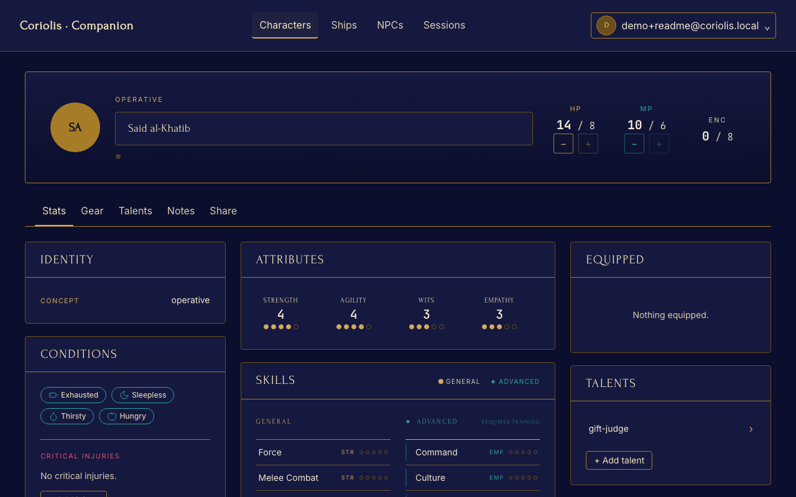

### По приложению

<table>
  <tr>
    <td width="50%"><a href="docs/screenshots/desktop/dashboard.png">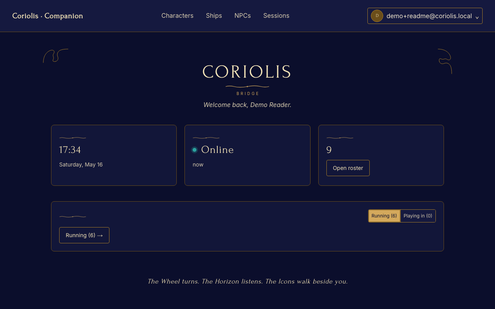</a><br/><sub><b>Мостик</b> — сессия дня одним взглядом.</sub></td>
    <td width="50%"><a href="docs/screenshots/desktop/characters-list.png">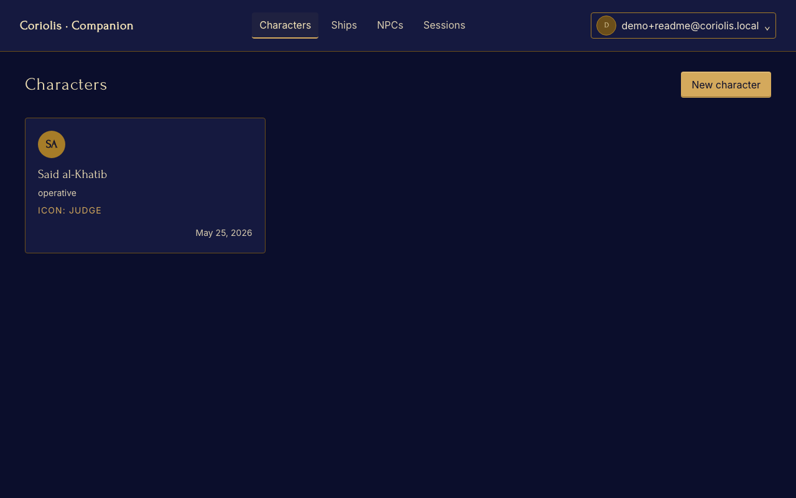</a><br/><sub><b>Персонажи</b> — ваш ростер.</sub></td>
  </tr>
  <tr>
    <td width="50%"><a href="docs/screenshots/desktop/game-session.png">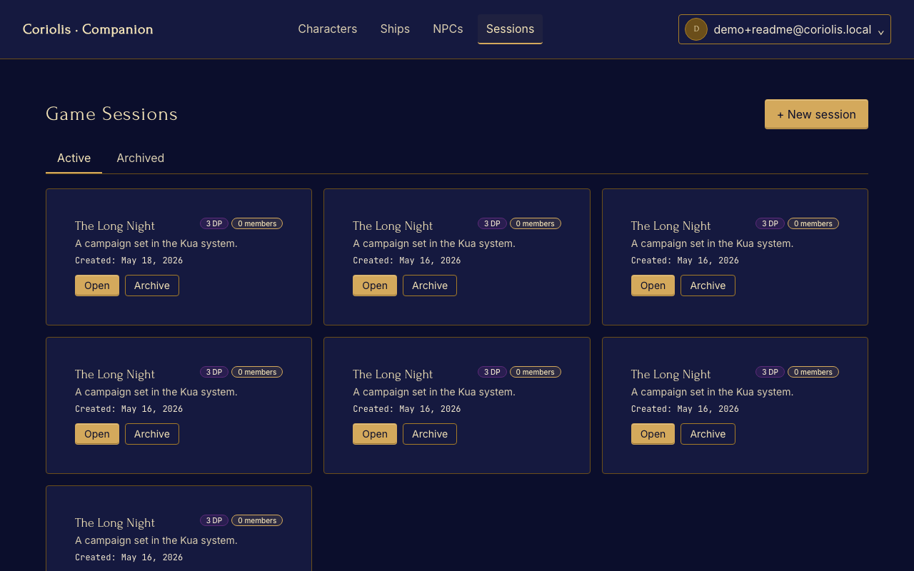</a><br/><sub><b>Сессии</b> — трекер DP, участники, архив.</sub></td>
    <td width="50%"><a href="docs/screenshots/desktop/npc-editor.png">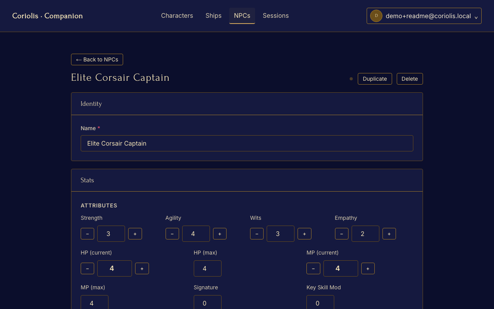</a><br/><sub><b>NPC</b> — враги и союзники ведущего.</sub></td>
  </tr>
  <tr>
    <td width="50%"><a href="docs/screenshots/desktop/shared-character.png">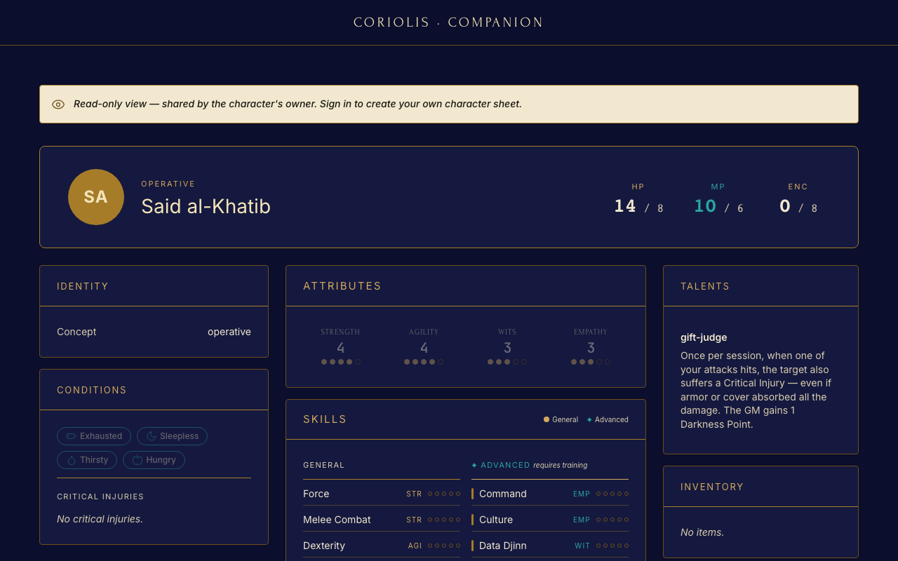</a><br/><sub><b>Публичная шара</b> — read-only ссылка с опциональными заметками GM.</sub></td>
    <td width="50%"><a href="docs/screenshots/desktop/landing.png">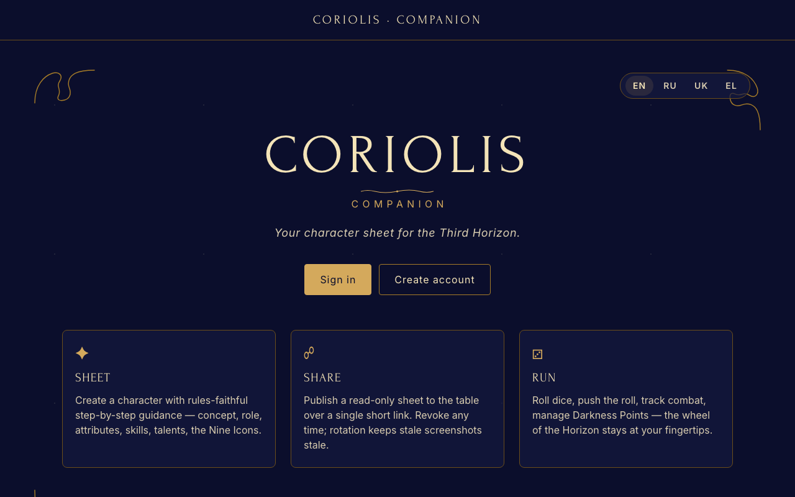</a><br/><sub><b>Лендинг</b> — три столпа: Sheet · Share · Run.</sub></td>
  </tr>
</table>

### Мобильный вид (web-responsive, 414 × 896)

<table>
  <tr>
    <td width="25%">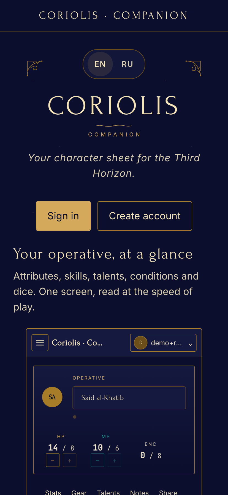</td>
    <td width="25%">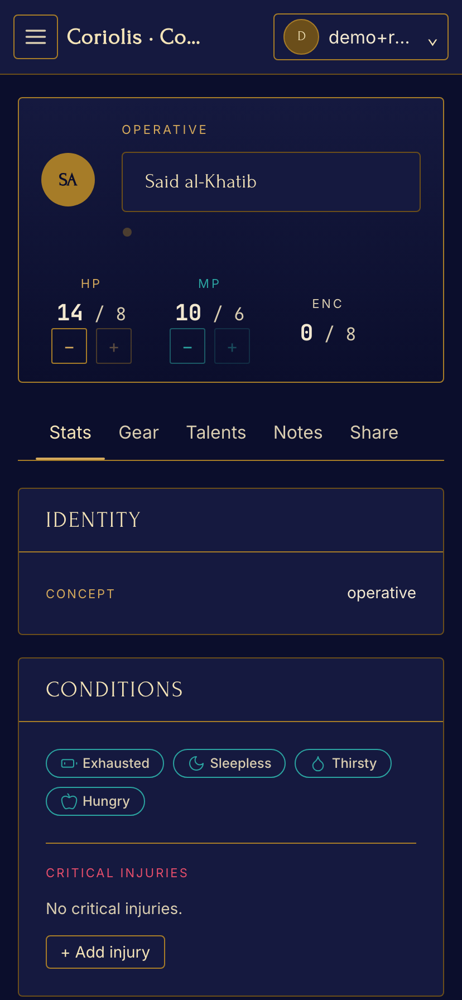</td>
    <td width="25%">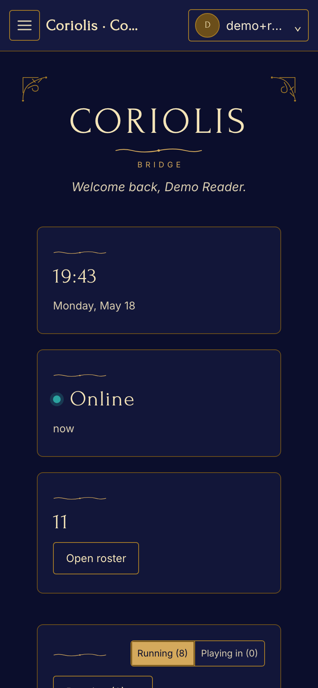</td>
    <td width="25%">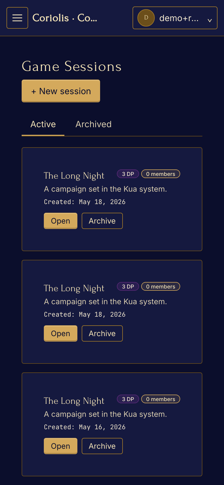</td>
  </tr>
  <tr>
    <td align="center"><sub>Лендинг</sub></td>
    <td align="center"><sub>Персонаж</sub></td>
    <td align="center"><sub>Мостик</sub></td>
    <td align="center"><sub>Сессии</sub></td>
  </tr>
</table>

> Нативный Flutter-клиент (`apps/mobile`) рендерит те же данные через
> Material-виджеты, привязанные к общим токенам дизайна. Нативные
> скриншоты будут добавлены вместе с профилем cold-start (см.
> [`docs/done/phase-7.md`](docs/done/phase-7.md)).

## Возможности

### Для игроков

- **Лист персонажа** — Coriolis-каноничный: девять икон, концепт,
  происхождение, атрибуты (1–5), общие и продвинутые навыки, таланты,
  снаряжение, состояния, перегрузка, критические травмы.
- **Броски кубов** — пул D6, поддержка push: шестёрки — успехи, единицы
  при push отдают GM очки Тьмы (Darkness Points).
- **Публичные шары листа** — read-only ссылка для остального стола,
  опциональный показ заметок GM, мгновенный revoke.
- **JSON-экспорт** — лист, корабль и история выгружаются через
  `GET /api/v1/me/export` для бэкапов и сторонних инструментов.
- **Оффлайн** — чтение везде; запись на web (ServiceWorker-очередь) и
  на mobile (Hive); изменения синхронизируются при возвращении сети.

### Для ведущих

- **Листы кораблей** — 20 классов (ST3001 ГЛАВА 7), модули, экипажные
  позиции, корпус / энергия / сигнатура / броня, отслеживание проблем.
- **Игровые сессии** — приглашения, роли, архив, трекер Darkness Points
  с историей.
- **NPC и стычки** — преген и кастомные NPC, конструктор стычек с
  инициативой и продвижением раундов / ходов.
- **Real-time стол** — броски, изменения DP и чат идут через Centrifugo
  — все участники видят одно и то же состояние.

### Общее для всех клиентов

- **Три полноценных клиента** — Nuxt 4 SPA, Flutter 3.41 (iOS / Android)
  и NestJS 11 бэкенд, все сгенерированы из общих OpenAPI + AsyncAPI
  спецификаций.
- **Четыре локали** — английская, русская, украинская, греческая;
  паритет ключей проверяется в CI.
- **Брендированный дизайн-система** — `@app/ui` для Vue, `app_ui` для
  Flutter, общая пайплайн токенов (`specs/design/tokens/*.json`).
- **Наблюдаемость** — OpenTelemetry → локальная Grafana / LGTM, Sentry
  на бэкенде и mobile.

## Quick start

```sh
pnpm install
pnpm spec:codegen                # сгенерировать TS + Dart клиенты из спеки
pnpm design:build                # CSS / TS / Dart токены
docker compose -f docker/compose.yml up -d
curl localhost:3010/api/v1/health
# → {"status":"ok","dependencies":{"db":"ok","redis":"ok","centrifugo":"ok"}}
```

Web — http://localhost:3001, Centrifugo health — http://localhost:8000.

## Документация

- Полный технический README на английском: [`README.md`](README.md).
- Продуктовая спецификация: [`docs/PRD.md`](docs/PRD.md).
- Дизайн-система: [`docs/DESIGN.md`](docs/DESIGN.md).
- План фаз: [`docs/IMPLEMENTATION_PLAN.md`](docs/IMPLEMENTATION_PLAN.md).
- Операционный мануал агентов: [`AGENTS.md`](AGENTS.md).

## Лицензия

[MIT](LICENSE). Фанатский проект; _Coriolis: The Third Horizon_ —
торговая марка Free League Publishing, проект не аффилирован с издателем.
