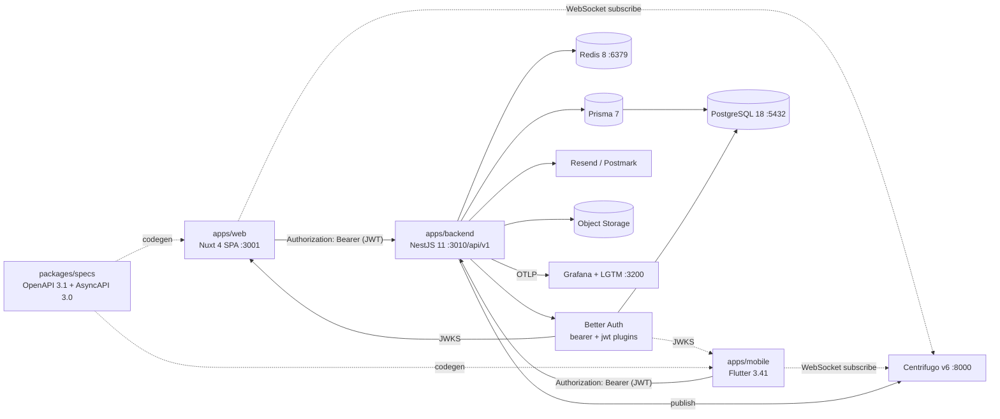

# Coriolis Companion App — Product Requirements Document

**Version:** 2.0 (adapted to the `claude-driven-nest-nuxt-flutter-monorepo` boilerplate)
**Status:** Ready for implementation planning
**Last updated:** April 2026

---

## 1. Executive Summary

The Coriolis Companion App is a cross-platform application that helps players and Game Masters of _Coriolis: The Third Horizon_ (Free League Publishing) create, manage, and play characters digitally. It replaces the paper character sheet with a responsive, share-friendly digital sheet, adds GM-side tooling for running sessions (combat tracker, NPC library, Darkness Points), and supports ship sheets for crews operating starships in the Third Horizon.

The product ships as **three first-class clients on day one**, served by a single backend:

- A **Nuxt 4 SPA** (web) for the desk and the table.
- A **Flutter 3.41 app** (mobile) for phones at the table.
- A **NestJS 11 REST API** (backend) — the single contract both clients consume, generated from a versioned OpenAPI 3.1 spec.

This is enforced by the monorepo's spec-first workflow: every endpoint exists in `packages/specs/openapi/openapi.yaml` before it ships, and the TypeScript and Dart clients are regenerated from that spec. CI fails if either client drifts.

The visual identity is faithful to the source material — ornate Arabian-sci-fi motifs, a brass-and-indigo palette, and typography that evokes Roman inscription and starship telemetry — with glyph coverage for the v1 locales (English and Russian). Brand colors are exposed only as design tokens; Stylelint blocks hex literals at commit time.

This document defines the product, user experience, and technical architecture in enough detail to start implementation, expressed in the conventions the monorepo already enforces.

---

## 2. Goals & Non-Goals

### 2.1 Goals

- Replace the paper character sheet with a fully digital, mobile-friendly equivalent on web and mobile.
- Reduce bookkeeping during play: auto-calculated derived stats, push tracking, condition tracking, encumbrance.
- Make characters easy to share with a GM or fellow player via a single link, no account needed for the viewer.
- Give GMs a single screen to run encounters: initiative, HP/MP tracking, Darkness Points, and quick NPC reference.
- Support ship sheets for crew-owned vessels with the same fidelity as character sheets.
- Stay rules-faithful to the Coriolis core book and Atlas Compendium.
- Ship in two locales (en / ru) at v1. The boilerplate's i18n pipeline already wires four locales (en / ru / uk / el); we populate two and leave the uk / el stubs for a later release.

### 2.2 Non-Goals (v1)

- Adventure module distribution or campaign management.
- Voice / video integration.
- Real-time collaborative _editing_ (CRDT / multiplayer cursors). Sharing is read-only; combat tracker pushes are one-way GM → players via Centrifugo.
- Marketplace or paid content.
- Foundry VTT / Roll20 integrations.
- AI-assisted character generation or NPC writing.
- Full ship-to-ship combat automation (basic ship sheet only; combat is GM-narrated).
- iOS / Android binaries published to stores in v1 — the Flutter app is part of the product, but store submission is a v1.1 concern.

---

## 3. Personas & Roles

| Role                 | Description                                             | Primary needs                                                                          |
| -------------------- | ------------------------------------------------------- | -------------------------------------------------------------------------------------- |
| **Player**           | Active in a Coriolis campaign, owns 1–3 characters.     | Fast sheet edits at the table, roll dice, push rolls, share sheet with GM.             |
| **GM**               | Runs the campaign. Often also a Player at other tables. | Combat tracker, NPC quick-stats, Darkness Points, view player sheets via shared links. |
| **Anonymous Viewer** | Receives a share link, no account.                      | Read-only access to a character or ship sheet.                                         |
| **New Player**       | Trying the system for the first time.                   | Guided character creation, in-context rule explanations.                               |

System roles map cleanly: `USER` (registered), `ADMIN` (system maintenance, defined in v1.1+). Anonymous viewers carry no role — they hold a signed share token, validated server-side per request.

---

## 4. User Stories (by epic)

### Epic A — Account & Identity

- As a new user, I can register with email and password and receive a verification email.
- As a registered user, I can log in, log out, reset my password, edit my display name, and delete my account.
- As any user, my session persists across reloads but expires after 30 days of inactivity.

### Epic B — Character Creation

- As a player, I can create a new character via a guided wizard (Concept → People & Background → Icon → Attributes → Skills → Talents → Gear → Relationships).
- As a player, I can skip the wizard and start with a blank sheet for fast entry.
- As a player, I can save a draft mid-creation and return to it later.

### Epic C — Character Sheet

- As a player, I can view and edit any field on my sheet, with auto-save.
- As a player, derived stats (HP max, MP max, encumbrance limit, initiative bonus) recalculate live as I edit base attributes.
- As a player, I can mark conditions (Exhausted, Sleepless, Thirsty, Hungry) and apply their −1 dice penalty automatically when rolling.
- As a player, I can track current HP, current MP, critical injuries, and reputation in a persistent header.

### Epic D — Inventory & Gear

- As a player, I can add weapons, armor, gear, cybernetics, and birr to my inventory.
- As a player, I can edit any item's name, description, weight, quantity, and stats (damage / crit / range for weapons; armor rating for armor).
- As a player, I see total encumbrance and a warning when over the limit.
- As a player, I can mark items as equipped / stowed.

### Epic E — Dice & Mechanics

- As a player, I can roll a dice pool (Attribute + Skill + Gear bonus + situational modifier), see successes (6s), and see prayer-eligible state.
- As a player, I can push a roll: rerolling non-6s at the cost of generating one Darkness Point — sent live to the active session via Centrifugo if connected, logged on the character otherwise.
- As a player, I can roll initiative and store the result for the GM to import into the combat tracker.

### Epic F — Sharing

- As a player, I can generate a public share link for a character or ship.
- As a player, I can revoke any share link, immediately invalidating it.
- As a viewer, I can open a share link without an account and see a read-only sheet.
- As a player, I can see which links are active and when they were last viewed.

### Epic G — Ship Sheets

- As a crew, we can create a ship and assign owner crew members.
- As a player, I can view the ship sheet from my dashboard if I'm assigned crew.
- As crew, we can edit hull, signature, modules, weapons, problems, and history.

### Epic H — GM Tools

- As a GM, I can create a `GameSession` that links the player characters at my table.
- As a GM, I can launch a combat tracker for the session: build initiative, track HP / MP / conditions for PCs and NPCs side by side, advance rounds.
- As a GM, I can maintain a private NPC library with full stat blocks and pull NPCs into combat.
- As a GM, I can track Darkness Points for the session, with all player pushes adding to the pool automatically over Centrifugo.
- As a GM, I can read (but not edit) the live sheets of my players if they've shared with the session.

---

## 5. Functional Requirements

### 5.1 Authentication (Better Auth, JWT bearer)

The API is a **stateless bearer-token API**. Both the Nuxt SPA and the Flutter app speak the same auth contract — there is no per-platform auth glue.

Better Auth is mounted under URI versioning at `/api/v1/auth/*`, configured with two plugins:

- **`bearer` plugin** — issues an opaque session token in the `set-auth-token` response header on sign-in. Clients store it and send it as `Authorization: Bearer <session_token>` on every request.
- **`jwt` plugin** — exposes `/api/v1/auth/token` (returns a short-lived JWT signed via the active key) and `/api/v1/auth/jwks` (returns the public keys). This enables stateless JWT verification at the resource server with no DB lookup per request.

Token model:

- **Session token** (Better Auth–managed, opaque): TTL 30 days, rolling on use, persisted hashed in DB. The long-lived credential the client holds onto.
- **Access token** (JWT, recommended): TTL 15 minutes, signed with a key whose public counterpart is published via JWKS. Obtained by `POST /api/v1/auth/token`. Used for `Authorization: Bearer <jwt>` on resource calls.
- **Token rotation:** Better Auth rotates JWKS keys automatically (default 30-day rotation); session token reuse after revocation invalidates the family.

Token storage by client:

- **Web (Nuxt):** session token in `localStorage`, with a strict CSP and escape-by-default Vue templating mitigating the XSS exposure. Access JWT in memory only.
- **Mobile (Flutter):** session token in `flutter_secure_storage` (Keychain on iOS, Keystore on Android — already wired in `apps/mobile`). Access JWT in memory only.

Auth surface:

- Email + password registration with verification email; verification token expires in 24h.
- Password requirements: min 12 characters, must include 3 of {uppercase, lowercase, number, symbol}.
- Password reset via signed email link (1h expiry).
- Bearer auth means **CSRF is not a vector** for state-changing requests (no auto-attached credentials). Strict CORS with an explicit origin allowlist (Nuxt origin in dev/prod, plus the Flutter scheme); `Access-Control-Allow-Credentials` is unnecessary in pure-bearer mode.
- Logout (`POST /api/v1/auth/sign-out`) revokes the session token server-side; the client clears local storage.
- Account deletion is soft-delete with 30-day grace period; all session tokens are revoked immediately on deletion request; characters and ships cascade-delete after grace.

The boilerplate already ships a working auth vertical on both web and mobile (welcome / sign-in / sign-up screens, `AuthCubit`, `AuthGate`). v1 reuses it; we add display-name, account deletion, and the verification-email copy.

### 5.2 Character Sheet

The sheet is one canonical data model with multiple views (compact mobile, full desktop, GM read-only). Field shape is identical across all three clients because they consume the same generated DTOs from `@app/api-client-ts` and `app_api_client`.

**Identity:** name, concept, group / people, background, icon, portrait URL (optional), appearance text.
**Attributes:** Strength, Agility, Wits, Empathy (each 1–5).
**Skills (general):** Dexterity, Force, Infiltration, Manipulation, Melee Combat, Observation, Ranged Combat, Survival (each 0–5).
**Skills (advanced):** Command, Culture, Data Djinn, Medicurgy, Mystic Powers, Pilot, Science, Technology (each 0–3 typical).
**Talents:** array of `{ name, description, iconAffinity? }`.
**Resources:** HP current/max, MP current/max, Reputation, Birr (currency), XP earned/spent.
**Conditions:** boolean flags for Exhausted, Sleepless, Thirsty, Hungry, plus a list of Critical Injuries.
**Personal:** personal problem (text), relationships (array of `{ npcName, type, description }`).
**Inventory:** see 5.3.
**Notes:** free-form Markdown.

Derived values are computed by a single `RulesEngine` service in `apps/backend` (validated server-side on every write) and reflected into the response DTO so all three clients display the same numbers without duplicating the formulas:

- HP max = STR + AGI.
- MP max = WIT + EMP.
- Encumbrance limit = STR × 2.
- Push availability = roll has at least one die showing non-6 and character is not Exhausted.

### 5.3 Inventory & Gear

Items are typed: `WEAPON | ARMOR | GEAR | CYBERNETIC | SHIP_MODULE | OTHER`. Common fields: name, description, quantity, weight (in slots, 0.5 increments), value in birr, equipped (bool), stowed_location (optional).

Type-specific fields:

- **Weapon:** damage, crit, range (Engaged / Short / Medium / Long / Extreme), bonus (modifier dice), features (array of tags), ammo (current / max).
- **Armor:** armor rating, features.
- **Cybernetic:** systemStrain cost, features.
- **Ship module:** energy points, slot type — used on ship sheets only.

Encumbrance is the sum of weights of non-stowed items; over-encumbrance triggers a UI warning but does not block actions. The OpenAPI schema models the type-specific fields as a discriminated union (`oneOf` + `discriminator: type`) so generated clients on both sides are correctly typed.

### 5.4 Sharing

Each character and ship has a `ShareLink` record with a URL-safe random slug (24+ chars). Reading the slug yields a read-only render. Owner can revoke; revocation is immediate (no token refresh window). Last-viewed timestamp and view count are recorded for the owner's audit panel.

Because Nuxt runs in **SPA mode (`ssr: false`)**, the share-link route (`/shared/character/:slug`) is a client-rendered page that fetches the public payload from `GET /api/v1/public/character/:slug` on mount. To preserve link previews on social/Discord, the API surfaces an `OpenGraph` rendering route (`GET /api/v1/public/og/character/:slug.png`) that produces a static 1200×630 image with the character's name and Icon glyph, served with long cache headers and revalidated when the sheet changes. The HTML page itself sets dynamic `<meta>` tags on the client; bots see the OG image regardless.

Anonymous viewers see a banner: _"Shared by [display name] — last updated [time]. This view is read-only."_ No edit affordances are rendered. Notes flagged "GM-only" are hidden from share views unless the link was generated with the `includeGmNotes` flag.

### 5.5 Ship Sheets

A ship is a separate top-level entity owned by a user and assignable to a `GameSession`. Crew members are linked Characters. The ship sheet mirrors the structure of a character sheet but with ship-appropriate fields:

- Identity: name, model, class, registry.
- Stats: hull points, armor, signature, energy points, maneuverability, acceleration, jump unit, sensors, comms.
- Modules: array of installed modules with energy use.
- Weapons: array of ship weapons with arc, range, damage.
- Problems: list of active mechanical problems (per Coriolis ship rules).
- History: free-form text.
- Crew: array of Character references with assigned roles (Captain, Pilot, Sensor Op, Gunner, Engineer, Service Crew).

### 5.6 Dice Roller

Floating panel accessible from any authenticated screen on web; bottom-sheet on mobile. Inputs: pool size, optional label, optional skill / attribute reference. Output: each die rendered as a d6 face, count of 6s, prayer button if any non-6s.

Pushing a roll:

1. Reroll all non-6 dice once.
2. Increment Darkness Points on the active session by 1 (if linked) or on the character by 1 (if not).
3. Mark the character as `pushedThisRoll = true` for UI feedback.
4. After a push, the original dice remain visible alongside the rerolls.
5. If the player is connected to a `GameSession`, publish a `roll.pushed` event to the session's Centrifugo channel — the GM screen updates the DP counter in real time.

A roll history (last 50 rolls per character) is kept for player and GM review. Storage and aggregation live in the `dice` module on the backend.

### 5.7 GM Tools

**`GameSession`:** a container with name, system notes, list of player characters, optional assigned ship, current Darkness Points, status (active / archived). Distinct from Better Auth's `Session` table — the boilerplate reserves that name for the auth session, so the GM-side concept is **always** `GameSession`.

**Combat Tracker:**

- Build initiative by importing PC initiative rolls + GM-rolled NPCs.
- Round counter, active turn highlight.
- Per-combatant: name, current HP, current MP, conditions, quick action (deal damage, heal, apply condition).
- "End encounter" button archives the encounter to the session log.
- State changes broadcast over a per-session Centrifugo channel (`session.<gameSessionId>`) so player devices see the GM's edits live without polling. The channel contract lives in `packages/specs/asyncapi/centrifugo.yaml`.

**NPC Library:** GM's private collection of stat blocks. Same shape as character sheets but with simplified fields and no Icon / personal-problem requirements. Tagging system for retrieval ("pirate," "patrol officer," "djinni").

**Darkness Points:** a counter per session. Player pushes increment it; GM can spend points (decrement with a reason text logged to session history). All DP changes flow through `POST /api/v1/game-sessions/:id/dp` and rebroadcast over the session channel.

---

## 6. Non-Functional Requirements

- **Performance:** Time-to-interactive ≤ 2.5s on 3G mobile (Lighthouse) for the Nuxt SPA. Sheet edit auto-save round-trip ≤ 500ms p95. Mobile cold start (Flutter) ≤ 2.0s on a mid-range Android.
- **Availability:** 99.5% uptime target. No SLA needed in v1.
- **Accessibility:** WCAG 2.1 AA. Keyboard navigable, screen-reader labeled, minimum 4.5:1 contrast despite the brass-on-indigo palette (see DESIGN.md for accessible variants). Every `@app/ui` component must pass the Storybook `addon-a11y` panel — non-negotiable for merge.
- **Security:** OWASP Top 10 baseline. CSRF is N/A under pure bearer auth (no auto-attached credentials); strict CORS allowlist is required instead. All write endpoints validate the `Authorization` header and decode the JWT against the cached JWKS. `express-openapi-validator` rejects any request body not matching the spec — defense-in-depth against shape drift. Rate limit auth endpoints (5/min/IP via `@nestjs/throttler`) and apply per-user rate limits on roll / auto-save endpoints. Session tokens are stored hashed (Better Auth managed). Share slugs are random (≥ 24 chars) and not enumerable. Strict Content Security Policy on the Nuxt app to mitigate the XSS-vs-localStorage exposure. Secret scanning (TruffleHog) runs on every PR.
- **Privacy:** Email is the only PII collected. No third-party trackers. Share-link view counts are anonymized. The mobile app uses Sentry Flutter and the backend uses Sentry + OpenTelemetry; both are scrubbed of email/IP via Sentry's `beforeSend` hook.
- **Errors:** All API errors are RFC 9457 `application/problem+json`. The `title` and `detail` fields stay English-canonical; user-visible localization happens in the client via i18n keys triggered by the error `type`.
- **Internationalization:** v1 ships **English and Russian (en / ru)**. The boilerplate's i18n pipeline already wires four locales (en / ru / uk / el) across web (@nuxtjs/i18n with colocated `<i18n lang="json">` blocks), mobile (slang with `auth` / `common` / `settings` / `coriolis` namespaces), and backend (nestjs-i18n with `<locale>/<namespace>.json`); for v1 we populate two and leave the uk / el stubs for a later release. No string ships as a literal — `pnpm check:i18n` enforces key parity for the active locales at CI.
- **Offline:** the character sheet view is read-cached on both clients (service worker on web; SQLite + repository pattern on mobile) so a player who loses connectivity at the table can still see their sheet. Edits queue and sync on reconnect.
- **Data export:** any user can export all their characters and ships as JSON from settings (GDPR / portability), via `GET /api/v1/me/export`.
- **Observability:** every backend HTTP request emits an OTLP span; Centrifugo publishes are spanned with the originating request as parent. Grafana dashboards (local: `:3200`) show p95 latency, error rate, and DP-event volume per session.
- **Configuration:** the backend reads no `process.env` directly. All configuration goes through `AppConfig` (typed, validated at boot). Adding a new config key means: add it to `AppConfig`, add it to `.env.example`, add it to the deploy config — never sprinkle `process.env.X` across modules.

---

## 7. Technical Architecture

### 7.1 Stack

- **Frontend (web):** Nuxt 4 SPA (`ssr: false`), Vue 3, Vite, Nuxt UI v4, Tailwind v4, `@nuxtjs/i18n`, SCSS with BEM and design-token CSS custom properties.
- **Frontend (mobile):** Flutter 3.41, Dart 3.8, `flutter_bloc` for state, `get_it` for DI, Dio for HTTP, `slang` for i18n, `flutter_secure_storage` for tokens, Firebase Messaging for push, Sentry Flutter.
- **Brand component library:** `@app/ui` (Vue, in `packages/ui`) and `app_ui` (Flutter, in `packages/ui_flutter`). Every component is colocated with a Storybook story (`*.stories.ts`) and a Vitest spec (`*.spec.ts`) on the Vue side; Flutter widgets ship with widget tests. CI rejects any `@app/ui` component missing either.
- **Backend:** NestJS 11 with `@nestjs/cqrs` (commands / queries / events), modular by domain, REST API documented via OpenAPI 3.1 in `packages/specs/openapi/openapi.yaml` and validated at runtime by `express-openapi-validator`.
- **DB:** PostgreSQL 18, Prisma 7 as ORM and migration tool. Auth tables (`user`, `session`, `account`, `verification`, `jwks`) are owned by Better Auth's CLI; domain tables are added in the same `schema.prisma`.
- **Auth:** Better Auth, mounted at `/api/v1/auth/*` with `bearer` + `jwt` plugins.
- **Realtime:** Centrifugo v6 (already in `docker/compose.yml`). The backend issues short-lived Centrifugo JWTs via `POST /api/v1/realtime/token` (TTL ≤ 5 min). Channel contracts live in `packages/specs/asyncapi/centrifugo.yaml`; the TypeScript channel constants in `packages/api-client-ts/src/realtime/channels.ts` are generated from it.
- **File storage:** S3-compatible object storage for character portraits. Signed upload URLs from the API.
- **Email:** Transactional email via Resend or Postmark, abstracted behind a `MailerPort` so the dev environment uses the boilerplate's mock adapter.
- **Hosting:** Frontend (Nuxt static SPA) on Vercel or Netlify; API + DB + Redis + Centrifugo on Railway, Fly.io, or a single-node VPS for v1. Database backups daily.
- **Local stack:** `docker compose -f docker/compose.yml up -d` brings up postgres / redis / centrifugo / backend / web / grafana with the repo mounted as a volume — `pnpm dev` is **not** run alongside, the containers reload on edit.

### 7.2 Spec-first workflow (non-negotiable)

Every feature on the API surface follows this loop, enforced by the boilerplate's `codegen-drift` CI job:

1. Edit `packages/specs/openapi/openapi.yaml` (or `asyncapi/centrifugo.yaml` for realtime).
2. Run `pnpm spec:validate && pnpm spec:bundle && pnpm spec:codegen`.
3. Implement the route in `apps/backend` — the runtime validator rejects anything that drifts.
4. Consume from `apps/web` via `@app/api-client-ts` and from `apps/mobile` via `app_api_client` — both are read-only generated trees.
5. Land the codegen artefacts in their own commit so review is mechanical.

### 7.3 High-level architecture



### 7.4 NestJS module map (CQRS-shaped)

Each domain module follows the boilerplate's CQRS layout: commands in `commands/`, queries in `queries/`, events in `events/`, controllers stay thin and dispatch through `CommandBus` / `QueryBus`.

- `AuthModule` — Better Auth wiring (bearer + jwt plugins), guards that decode the JWT against the cached JWKS, role decorators.
- `UsersModule` — profile, settings, account deletion. Wraps the Better Auth `user` table with domain-friendly endpoints.
- `CharactersModule` — character CRUD as commands / queries, derived-stat validation, JSON export. Emits `character.updated` events.
- `InventoryModule` — items nested under characters.
- `ShipsModule` — ship CRUD, crew assignment.
- `SharingModule` — share link generation, revocation, public read endpoints, OG image rendering.
- `GameSessionsModule` — GM session container.
- `CombatModule` — combat tracker state + Centrifugo publishing.
- `NpcsModule` — GM-private NPC library.
- `DiceModule` — roll persistence; Darkness Points coordination via session events.
- `RealtimeModule` — Centrifugo connection-token endpoint, channel ACL.
- `RulesEngineModule` — pure functions: `computeHpMax`, `computeMpMax`, `computeEncumbrance`, `canPush`. The single home for the formulas — house-rule changes are a one-file edit.
- `CommonModule` — `AppConfig`, Prisma service, validation pipes, RFC 9457 problem+json exception filter, JWKS cache, i18n integration.

### 7.5 Frontend route map (Nuxt, SPA)

```
/                          landing (public, client-rendered)
/auth/sign-in, /auth/sign-up, /auth/verify, /auth/forgot, /auth/reset
/app                       dashboard (auth)
/app/characters            list
/app/characters/new        wizard
/app/characters/:id        sheet (tabs: stats, gear, talents, notes, share)
/app/ships, /app/ships/:id
/app/game-sessions, /app/game-sessions/:id   (GM)
/app/game-sessions/:id/combat                (GM)
/app/npcs                  (GM)
/app/settings
/shared/character/:slug    public read-only (client-rendered, OG image served from API)
/shared/ship/:slug         public read-only
```

### 7.6 Flutter feature map (mobile)

The mobile app uses the feature-first layout already in `apps/mobile/lib/features`:

```
features/
  auth/         (already wired — welcome / sign-in / sign-up + AuthCubit)
  characters/   (list, sheet, wizard) — domain / data / presentation
  ships/        (list, sheet)
  game_sessions/ (list, detail, combat tracker — GM)
  npcs/         (GM)
  settings/
core/
  api/          (uses generated app_api_client)
  realtime/     (Centrifugo client, channel subscriptions)
  rules_engine/ (mirror of backend formulas, validated against backend response)
  storage/      (offline cache via Drift or sqflite)
```

The mobile combat tracker is a simplified one-combatant-at-a-time card with prev / next swipe (see DESIGN.md §8). Full combat-tracker UX is desktop-shaped; mobile is for read-along + DP push.

---

## 8. Data Model (Prisma 7 sketch)

### 8.1 Auth tables (managed by Better Auth)

Better Auth's CLI (`npx @better-auth/cli generate`) owns: `user`, `session`, `account`, `verification`, `jwks`. Custom user fields (`displayName`, `deletedAt`) live on the same `user` table via Better Auth's `additionalFields` config.

The domain schema below references `user.id` for ownership. Because Better Auth reserves the `Session` model name for its own bearer-session table, the GM-side concept is **always** `GameSession` in this app — in code, in URLs, in the schema.

### 8.2 Domain tables

```prisma
// `user` table is owned by Better Auth (see §8.1). Domain models reference user.id.
// Below: domain-only models.

model Character {
  id              String   @id @default(cuid())
  ownerId         String   // -> user.id (Better Auth)
  name            String
  concept         String?
  people          String?
  background      String?
  icon            String?  // one of the 9 Icons
  portraitUrl     String?
  appearance      String?
  // attributes
  strength        Int      @default(2)
  agility         Int      @default(2)
  wits            Int      @default(2)
  empathy         Int      @default(2)
  // skills stored as JSON for flexibility; Zod schema in packages/specs
  skills          Json
  // resources
  hpCurrent       Int      @default(0)
  mpCurrent       Int      @default(0)
  reputation      Int      @default(0)
  birr            Int      @default(0)
  xpEarned        Int      @default(0)
  xpSpent         Int      @default(0)
  // text
  personalProblem String?
  notes           String?
  conditions      Json
  criticalInjuries Json
  createdAt       DateTime @default(now())
  updatedAt       DateTime @updatedAt
  items           Item[]
  talents         Talent[]
  relationships   Relationship[]
  shareLinks      ShareLink[]
  rolls           Roll[]
}

model Item {
  id            String   @id @default(cuid())
  characterId   String
  character     Character @relation(fields: [characterId], references: [id], onDelete: Cascade)
  type          ItemType
  name          String
  description   String?
  quantity      Int      @default(1)
  weight        Float    @default(0)
  value         Int?
  equipped      Boolean  @default(false)
  data          Json     // type-specific fields, validated against the OpenAPI discriminated union
}

enum ItemType { WEAPON ARMOR GEAR CYBERNETIC SHIP_MODULE OTHER }

model Talent {
  id           String   @id @default(cuid())
  characterId  String
  character    Character @relation(fields: [characterId], references: [id], onDelete: Cascade)
  name         String
  description  String
  iconAffinity String?
}

model Relationship {
  id           String   @id @default(cuid())
  characterId  String
  character    Character @relation(fields: [characterId], references: [id], onDelete: Cascade)
  npcName      String
  type         String?
  description  String?
}

model Ship {
  id              String   @id @default(cuid())
  ownerId         String
  name            String
  model           String?
  class           String?
  registry        String?
  hullCurrent     Int
  hullMax         Int
  armor           Int
  signature       Int
  energyPoints    Int
  maneuverability Int
  acceleration    Int
  data            Json     // modules, weapons, problems, history
  createdAt       DateTime @default(now())
  updatedAt       DateTime @updatedAt
  shareLinks      ShareLink[]
  crew            CrewAssignment[]
}

model CrewAssignment {
  id          String @id @default(cuid())
  shipId      String
  ship        Ship   @relation(fields: [shipId], references: [id], onDelete: Cascade)
  characterId String
  role        String
}

model ShareLink {
  id              String    @id @default(cuid())
  slug            String    @unique
  characterId     String?
  shipId          String?
  character       Character? @relation(fields: [characterId], references: [id], onDelete: Cascade)
  ship            Ship?      @relation(fields: [shipId], references: [id], onDelete: Cascade)
  createdAt       DateTime  @default(now())
  revokedAt       DateTime?
  lastViewedAt    DateTime?
  viewCount       Int       @default(0)
  includeGmNotes  Boolean   @default(false)
}

model GameSession {
  id             String      @id @default(cuid())
  ownerId        String      // GM
  name           String
  notes          String?
  darknessPoints Int         @default(0)
  status         String      @default("active") // active | archived
  createdAt      DateTime    @default(now())
  characterIds   String[]
  shipId         String?
  encounters     Encounter[]
  dpEvents       DpEvent[]
}

model Encounter {
  id            String      @id @default(cuid())
  gameSessionId String
  gameSession   GameSession @relation(fields: [gameSessionId], references: [id], onDelete: Cascade)
  name          String
  round         Int         @default(1)
  status        String      @default("active")
  combatants    Json
  createdAt     DateTime    @default(now())
}

model Npc {
  id        String   @id @default(cuid())
  ownerId   String
  name      String
  tags      String[]
  data      Json
  createdAt DateTime @default(now())
}

model Roll {
  id            String   @id @default(cuid())
  characterId   String?
  character     Character? @relation(fields: [characterId], references: [id], onDelete: Cascade)
  gameSessionId String?
  label         String?
  pool          Int
  results       Int[]
  pushed        Boolean  @default(false)
  pushedResults Int[]
  createdAt     DateTime @default(now())
}

model DpEvent {
  id            String      @id @default(cuid())
  gameSessionId String
  gameSession   GameSession @relation(fields: [gameSessionId], references: [id], onDelete: Cascade)
  delta         Int         // +1 for push, negative for spend
  reason        String?
  createdAt     DateTime    @default(now())
}
```

JSON columns are used where field shape varies (item type, ship class, NPC stat block). The trade-off is type-safety in code (recovered via the OpenAPI discriminated unions and validated at runtime by `express-openapi-validator`) for schema simplicity in the DB.

---

## 9. API Surface (sketch)

All routes live under `/api/v1`. Auth routes are mounted **inside** that versioning at `/api/v1/auth` (the boilerplate's convention). JSON request / response. RFC 9457 `application/problem+json` on errors. `Authorization: Bearer <token>` on every domain route except `public/*`.

```
# Auth (Better Auth, mounted at /api/v1/auth)
POST   /api/v1/auth/sign-up/email       (register; sends verification email)
POST   /api/v1/auth/sign-in/email       (returns session token in set-auth-token header)
POST   /api/v1/auth/sign-out
GET    /api/v1/auth/get-session
POST   /api/v1/auth/verify-email
POST   /api/v1/auth/forget-password
POST   /api/v1/auth/reset-password
POST   /api/v1/auth/token               (exchange session token for short-lived JWT)
GET    /api/v1/auth/jwks
GET    /api/v1/auth/list-sessions
POST   /api/v1/auth/revoke-session

# Realtime (Centrifugo)
POST   /api/v1/realtime/token           (Centrifugo JWT, TTL ≤ 5 min)

# Health
GET    /api/v1/health                   ({ status, dependencies: { db, redis, centrifugo } })

# Domain
GET    /api/v1/me
PATCH  /api/v1/me
DELETE /api/v1/me
GET    /api/v1/me/export                (JSON portability dump)

GET    /api/v1/characters
POST   /api/v1/characters
GET    /api/v1/characters/:id
PATCH  /api/v1/characters/:id
DELETE /api/v1/characters/:id
POST   /api/v1/characters/:id/duplicate
GET    /api/v1/characters/:id/export

POST   /api/v1/characters/:id/items
PATCH  /api/v1/items/:id
DELETE /api/v1/items/:id

POST   /api/v1/characters/:id/talents
PATCH  /api/v1/talents/:id
DELETE /api/v1/talents/:id

POST   /api/v1/characters/:id/share
GET    /api/v1/characters/:id/shares
DELETE /api/v1/shares/:id

POST   /api/v1/characters/:id/rolls
PATCH  /api/v1/rolls/:id/push

GET    /api/v1/ships, POST /api/v1/ships, etc.

GET    /api/v1/game-sessions, POST /api/v1/game-sessions
GET    /api/v1/game-sessions/:id
POST   /api/v1/game-sessions/:id/encounters
PATCH  /api/v1/encounters/:id
POST   /api/v1/game-sessions/:id/dp

GET    /api/v1/npcs, POST /api/v1/npcs, PATCH, DELETE

# Public (no auth)
GET    /api/v1/public/character/:slug
GET    /api/v1/public/ship/:slug
GET    /api/v1/public/og/character/:slug.png   (Open Graph preview image)
GET    /api/v1/public/og/ship/:slug.png
```

### 9.1 Realtime channels (AsyncAPI)

Defined in `packages/specs/asyncapi/centrifugo.yaml`:

| Channel                           | Direction            | Payload                                                               |
| --------------------------------- | -------------------- | --------------------------------------------------------------------- |
| `session.<gameSessionId>`         | Server → subscribers | `dp.changed`, `encounter.updated`, `combatant.updated`, `roll.pushed` |
| `character.<characterId>.private` | Server → owner       | `sheet.updated` (auto-save echo for cross-tab sync)                   |

Channel ACL is enforced server-side: a Centrifugo connection token (`POST /api/v1/realtime/token`) is signed only for channels the user is authorized to subscribe to.

---

## 10. Game-Rule Logic

The app encodes rules where they're computational and leaves narrative judgment to the GM. The single home for the formulas is the `RulesEngineModule` on the backend; clients re-derive nothing — they read the values the API returns.

Computational rules in v1:

- HP max, MP max, encumbrance limit (formulas in §5.2).
- Dice pool resolution (count 6s).
- Push: reroll non-6s once, increment DP.
- Condition penalty: −1 die per active condition when rolling (cap at the character's pool).
- Reputation: simple integer counter, no automatic effects.

Rules **not** encoded (intentionally narrative):

- Critical injury effects (GM decides; just stored as text on the character).
- Mystic Powers cost and effects.
- Talent activation timing.
- Ship-to-ship combat resolution.

A change to any formula is a single edit in `RulesEngineModule` + a version bump in the OpenAPI response schema if the calculated field's type changes.

---

## 11. Phased Roadmap

Each phase ends with a green CI run (lint / typecheck / test / spec-validate / codegen-drift / design-audit / i18n-parity), every feature recorded as a `done.md` entry with its PR link.

| Phase                          | Scope                                                                                                                                                                                        | Rough effort |
| ------------------------------ | -------------------------------------------------------------------------------------------------------------------------------------------------------------------------------------------- | ------------ |
| **Phase 0 — Adoption**         | Run `scripts/setup.sh` with Coriolis name/slug, replace starter Prisma schema with §8 domain, seed `specs/design/tokens/*.json` from DESIGN.md, replace placeholder copy in `<i18n>` blocks. | ~1 week      |
| **Phase 1 — Foundation**       | Empty-sheet CRUD on backend (OpenAPI-first), Nuxt sheet skeleton, Flutter sheet skeleton, `@app/ui` foundation primitives needed (Button, Card, Input, Badge, Chip, StatBlock).              | ~3 weeks     |
| **Phase 2 — Character Sheet**  | Full sheet (attributes, skills, talents, conditions), inventory, derived stats, auto-save, character creation wizard, Cyrillic string review for the wizard.                                 | ~4 weeks     |
| **Phase 3 — Sharing & Polish** | Share links, public read-only views (SPA + OG image route), mobile pass, accessibility audit, addon-a11y panel clean across `@app/ui`.                                                       | ~2 weeks     |
| **Phase 4 — Dice & Sessions**  | Dice roller (web + mobile), push mechanic, `GameSession`s, Darkness Points, Centrifugo channels for live DP.                                                                                 | ~2 weeks     |
| **Phase 5 — Ships**            | Ship sheets, crew assignment, ship sharing.                                                                                                                                                  | ~2 weeks     |
| **Phase 6 — GM Tools**         | Combat tracker (desktop-shaped; mobile read-along card), NPC library, GM session view. Realtime combatant updates.                                                                           | ~3 weeks     |
| **Phase 7 — Hardening**        | Offline support (web SW + Flutter SQLite), JSON export, performance tuning, beta release.                                                                                                    | ~2 weeks     |

Total: ~19 weeks for a single full-stack engineer at a steady pace. Faster with a team of two splitting backend (NestJS + Prisma) from frontend (Nuxt + Flutter sharing the generated clients).

### v1.1 expansion — shipped post-Beta

| Phase                                             | Scope                                                                                                                                                                                                                                                                                                                                                                                                                                                                                                      | Effort  |
| ------------------------------------------------- | ---------------------------------------------------------------------------------------------------------------------------------------------------------------------------------------------------------------------------------------------------------------------------------------------------------------------------------------------------------------------------------------------------------------------------------------------------------------------------------------------------------- | ------- |
| **Phase 8 — Player Client + Multiplayer Chat** ✅ | Two-role split: GM keeps `/app/game-sessions/*`, player gets `/app/sessions/*` (web) + `features/sessions/` (mobile). Single canonical invite link per session (rotate / revoke). `GameSessionMembership` replaces `characterIds` as the "who is at this table" contract. Bidirectional chat: session-wide broadcast + per-member whispers, persisted, paginated, realtime over Centrifugo, per-session block list, system messages. See `docs/done/phase-8.md` and `docs/IMPLEMENTATION_PLAN_PHASE_8.md`. | ~6 days |

---

## 12. Quality Gates & CI

The boilerplate's CI already enforces these — no v1 PR merges without:

- `pnpm spec:validate` — OpenAPI + AsyncAPI lint clean.
- `codegen-drift` — `pnpm spec:codegen` produces no diff against the committed tree.
- `express-openapi-validator` runtime tests — no route serves a body the spec doesn't allow.
- Stylelint — no hex literals in `apps/web` or `packages/ui` SCSS; no `!important`; no inline `style=""` with literals.
- `@app/ui` audit — every component folder has `*.vue + *.stories.ts + *.spec.ts + index.ts`.
- `pnpm design:audit` — every token used is documented, every component listed in `specs/design/README.md`.
- `pnpm check:i18n` — key parity across en / ru for backend, web, and mobile (active v1 locales).
- Vitest — backend coverage thresholds met; `@app/ui` specs green; web component specs green.
- TruffleHog — no secrets in the diff.
- `license-checker` — no dependencies outside the OSI-permissive allowlist.

---

## 13. Risks & Open Questions

- **Free League IP:** verify whether the project needs to operate under Free League's [Free League Workshop](https://freeleaguepublishing.com) community-content license, or stay engine-agnostic enough to avoid trademarks. Recommended v1 stance: non-commercial with a clear "fan project, not affiliated with Free League" attribution in the landing footer.
- **Rule supplements:** Atlas Compendium and other books extend skills, talents, and gear. The schema accommodates user-added talents and items from day one (free-form `name` + `description`); v2 ships a "supplement pack" toggle behind a feature flag.
- **Real-time GM/player sync:** v1 uses Centrifugo broadcasts, which is one-way (server → client). True multiplayer cursors during combat would require CRDT — defer to v2 if user feedback demands it.
- **Mobile-first vs. desktop-first:** the design philosophy is mobile-first for the _player_ (table play happens on phones) but the _GM combat tracker_ is desktop-shaped. Validate the tracker at 768px and confirm the simplified mobile card meets GM expectations.

---

## 14. Out of Scope (parking lot for v2+)

- Adventure / campaign log with shared GM/player journal.
- Foundry VTT module export.
- AI character portrait generation.
- Marketplace for community character templates.
- Ship-to-ship combat tracker.
- Multi-GM co-management of a session.
- Mobile push notifications for "your turn" alerts during combat (Firebase Messaging is wired but unused in v1).
- iOS / Android store submission (binaries build; store presence is a v1.1 concern).
- True multiplayer editing (CRDT).
- Localization beyond en / ru in v1. The boilerplate has uk / el stubs already wired in the i18n pipeline; populating them is a v1.1+ task.
